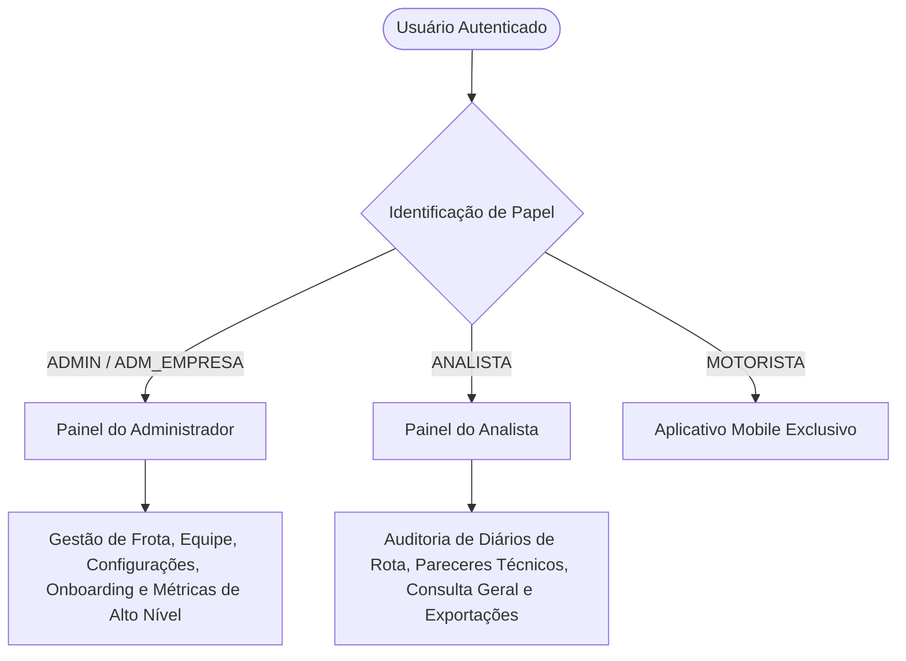

# Documentação Completa do Front-end - Ecossistema Efficientia

> **Versão da Aplicação**: 1.0.0  
> **Arquitetura**: Single Page Application (SPA) com React 19, TypeScript e Vite  
> **Público-Alvo**: Desenvolvedores, Engenheiros de Software, Analistas de Sistemas e Stakeholders do Projeto  
> **Alinhamento Normativo**: Portaria SDA/MAPA nº 1.280/2025 (Bem-estar animal e rastreabilidade no transporte rodoviário de carga viva bovina)

---

## Sumário

1. [Visão Geral do Projeto](#1-visão-geral-do-projeto)
2. [Arquitetura e Stack Tecnológica](#2-arquitetura-e-stack-tecnológica)
3. [Estrutura de Diretórios](#3-estrutura-de-diretórios)
4. [Design System e Temas (Light / Dark Mode)](#4-design-system-e-temas-light--dark-mode)
5. [Controle de Acesso e Perfis (RBAC)](#5-controle-de-acesso-e-perfis-rbac)
6. [Módulos e Telas da Aplicação](#6-módulos-e-telas-da-aplicação)
   - [6.1. Autenticação e Recuperação de Senha](#61-autenticação-e-recuperação-de-senha)
   - [6.2. Onboarding Linear da Transportadora](#62-onboarding-linear-da-transportadora)
   - [6.3. Painel de Controle (Dashboard do Administrador e do Analista)](#63-painel-de-controle-dashboard-do-administrador-e-do-analista)
   - [6.4. Esteira de Auditoria de Diários de Rota](#64-esteira-de-auditoria-de-diários-de-rota)
   - [6.5. Hub de Cadastros e Consultas Rápidas](#65-hub-de-cadastros-e-consultas-rápidas)
   - [6.6. Gestão de Equipe e Colaboradores](#66-gestão-de-equipe-e-colaboradores)
   - [6.7. Gestão de Frota (Cavalos e Carretas)](#67-gestão-de-frota-cavalos-e-carretas)
   - [6.8. Polos de Origem (Fazendas) e Destino (Frigoríficos SIF)](#68-polos-de-origem-fazendas-e-destino-frigoríficos-sif)
   - [6.9. Assistente Virtual Inteligente (Cinttia AI)](#69-assistente-virtual-inteligente-cinttia-ai)
7. [Camada de Serviços e Integração de APIs](#7-camada-de-serviços-e-integração-de-apis)
   - [7.1. Cliente HTTP e Interceptores](#71-cliente-http-e-interceptores)
   - [7.2. Mecanismo de Idempotência](#72-mecanismo-de-idempotência)
   - [7.3. Proxy Reverso e Resiliência da IA](#73-proxy-reverso-e-resiliência-da-ia)
8. [Gerenciamento de Estado Global](#8-gerenciamento-de-estado-global)
9. [Segurança e Resiliência](#9-segurança-e-resiliência)
10. [Instalação, Execução e Comandos de Build](#10-instalação-execução-e-comandos-de-build)

---

## 1. Visão Geral do Projeto

O **Efficientia Front-end** é a interface web corporativa do ecossistema Efficientia, projetada para a digitalização, monitoramento operacional e governança técnica do transporte rodoviário de bovinos entre propriedades rurais produtoras e plantas frigoríficas certificadas pelo Serviço de Inspeção Federal (SIF).

A solução elimina a necessidade de controle físico por fichas de papel, integrando diários de bordo gerados por condutores no aplicativo mobile Android com um painel web analítico de alta precisão. 

### Principais Objetivos de Negócio:
* **Conformidade Regulatória Rigorosa**: Atendimento à Portaria SDA/MAPA nº 1.280/2025, garantindo registro de dados sanitários (GTA), notas fiscais, tempos de trânsito, condições de desembarque e coleta de 4 assinaturas digitais auditáveis.
* **Redução de Perdas e Mortalidade**: Monitoramento contínuo da taxa de mortalidade em trânsito com metas internas estritas (`< 0,20%` do lote) e alertas em tempo real.
* **Segregação Clara de Responsabilidades**: Interfaces dedicadas e otimizadas para administradores de empresas de transporte e analistas técnicos de qualidade animal.
* **Disponibilidade Operacional Contínua**: Resiliência de dados através de cache local, sincronização de estado com o backend Java e assistência inteligente via IA corporativa.

---

## 2. Arquitetura e Stack Tecnológica

O projeto foi construído utilizando as ferramentas mais modernas do ecossistema JavaScript/TypeScript, prezando por tipagem estrita, performance de carregamento e facilidade de manutenção.

| Tecnologia / Biblioteca | Versão | Papel na Arquitetura |
| :--- | :--- | :--- |
| **React** | `19.x` | Biblioteca de interface reativa para montagem e reconciliação da DOM |
| **TypeScript** | `5.9.x` | Tipagem estática em 100% dos arquivos com verificação estrita (`strict: true`) |
| **Vite** | `8.2.x` | Bundler e servidor de desenvolvimento ultra-rápido com HMR nativo |
| **React Router DOM** | `7.x` | Roteamento declarativo com History API, query params e sincronização de abas |
| **Axios** | `1.7.x` | Cliente HTTP com suporte a interceptores de autenticação e cancelamento via AbortSignal |
| **CSS Puro + CSS Variables** | Padrão W3C | Estilização declarativa de alta performance sem dependência de frameworks pesados |
| **Canvas API Nativa** | Nativa | Renderização de gráficos vetoriais em alta densidade de pixels para exportação em PNG |
| **ESLint & TypeScript-ESLint** | `9.x` | Análise estática contínua de código com 0 tolerância a `any` ou avisos |

---

## 3. Estrutura de Diretórios

A estrutura segue o princípio de separação de responsabilidades em camadas limpas:

```text
c:/desenvolvimento/Interdisciplinar/
├── .github/                      # Workflows de CI/CD para validação automática de build e lint
├── docs/                         # Especificações técnicas, contratos de API e documentações
│   ├── SPEC-AI-ULTRATHINK-ASSISTANT.md
│   └── DOCUMENTACAO_FRONTEND_COMPLETA.md
├── public/                       # Favicons, manifestos e arquivos estáticos globais
├── src/
│   ├── assets/                   # Recursos visuais (imagens de caminhão, logomarcas vetoriais)
│   ├── components/               # Componentes reutilizáveis em toda a aplicação
│   │   ├── Feedback/             # Avatares genéricos, toasts e indicadores visuais
│   │   ├── Layout/               # AuthenticatedLayout, Sidebar, Navbar e Busca Global Instantânea
│   │   ├── PrivateRoute/         # Guardas de rota com proteção RBAC e fluxo de onboarding
│   │   └── icons/                # Biblioteca unificada de ícones SVG (sem uso de emojis)
│   ├── constants/                # Constantes de regras de negócio, papéis RBAC e endpoints
│   ├── contexts/                 # Contextos globais (AuthContext e ThemeContext)
│   ├── hooks/                    # Custom Hooks (useAuth, useTheme, useFetchData, useAiChat)
│   ├── pages/                    # Telas e módulos completos da aplicação
│   │   ├── AiTestWorkbench/      # Bancada de testes e telemetria da IA Cinttia
│   │   ├── CadastrosConsulta/    # Hub unificado de tabelas para perfil de Analista
│   │   ├── Cadastro/             # Registro inicial da transportadora
│   │   ├── Configuracao/         # Parâmetros de conta, regras operacionais e limites SIF
│   │   ├── Dashboard/            # Painéis gerenciais, gráficos interativos e auditoria de diários
│   │   ├── EsqueciSenha/         # Fluxo duplo de recuperação de credenciais
│   │   ├── FazendasUnidades/     # Gestão de polos de embarque (fazendas) e desembarque (frigoríficos)
│   │   ├── Frota/                # Gestão de veículos pesados (cavalos mecânicos e carretas)
│   │   ├── Home/                 # Página inicial institucional e landing page
│   │   ├── Login/                # Ponto central de login com detecção inteligente de perfil
│   │   ├── Motoristas/           # Gestão de colaboradores e credenciamento de acessos
│   │   ├── NotFound/             # Página 404 estilizada com navegação de retorno
│   │   └── Onboarding/           # Esteira linear em 3 etapas para configuração corporativa
│   ├── services/                 # Comunicação com APIs externas e regras de persistência
│   │   ├── api/                  # Configuração do Axios, headers de idempotência e LocalStorage
│   │   ├── aiService.ts          # Orquestração do assistente Cinttia e base de conhecimento offline
│   │   ├── authService.ts        # Autenticação de admins e colaboradores
│   │   ├── cadastroBaseService.ts# Gerenciamento de fazendas e unidades frigoríficas
│   │   ├── caminhaoService.ts    # Cadastro e vinculação da frota pesada
│   │   ├── empresaService.ts     # Configurações institucionais da transportadora
│   │   ├── funcionarioService.ts # Gestão e adesão de novos colaboradores
│   │   ├── redisChartService.ts  # Consulta de séries temporais cacheadas em Redis
│   │   └── relatorioService.ts   # CRUD e ciclo de vida de diários de viagem
│   ├── types/                    # Tipagens e contratos TypeScript rigorosos
│   ├── utils/                    # Utilitários de máscara, validação de CPF/CNPJ e formatação
│   ├── App.tsx                   # Declaração do roteador principal e barreiras de erro
│   ├── index.css                 # Reset CSS corporativo e variáveis globais do Design System
│   └── main.tsx                  # Ponto de entrada React montado na DOM
├── .env                          # Variáveis de ambiente da API Java (VITE_API_URL)
├── index.html                    # Template HTML principal com suporte a fontes Manrope e IBM Plex Sans
├── package.json                  # Manifesto de dependências e scripts operacionais
├── tsconfig.json                 # Configuração do compilador TypeScript
└── vite.config.ts                # Configuração do Vite com proxy reverso corporativo
```

---

## 4. Design System e Temas (Light / Dark Mode)

O sistema conta com um Design System proprietário baseado em **Variáveis CSS semânticas**, com suporte nativo e bidirecional a **Tema Claro (Light)** e **Tema Escuro (Dark)**.

### Paleta Cromática Institucional:
* **Background Profundo Dark**: `#071329` (Fundo primário da aplicação no modo noturno)
* **Superfície Card Dark**: `#0e2545` (Superfície de cartões, modais e containers)
* **Bordas Dark**: `#1e3a5f` (Bordas de alto contraste contra fundos escuros)
* **Primário Accent (Azul Corporativo)**: `#0f51ae` (Light) / `#2b7fef` (Dark)
* **Sucesso (Verde Bem-Estar)**: `#15803d` (Light) / `#4ade80` (Dark)
* **Alerta Crítico (Vermelho Mortalidade)**: `#dc2626` (Light) / `#f87171` (Dark)
* **Atenção Operacional (Amarelo Ressalva)**: `#d97706` (Light) / `#fbbf24` (Dark)

### Tipografia:
* **Títulos e Métricas**: `'Manrope', sans-serif` (legibilidade marcante para números e títulos analíticos).
* **Corpo e Tabelas**: `'IBM Plex Sans', sans-serif` (densidade informacional ideal para tabelas e formulários).

### Diretriz Estrita de Ícones:
> **Zero Emojis**: Todo o sistema utiliza exclusivamente componentes de ícones vetoriais SVG padronizados (`src/components/icons`), garantindo consistência visual em qualquer sistema operacional ou dispositivo.

---

## 5. Controle de Acesso e Perfis (RBAC)

O controle de privilégios opera por meio de papéis (Roles) normalizados gravados no JWT emitido pelo backend:



### Regras de Roteamento Protegido (`PrivateRoute`):
1. **Administrador (`ADMIN`, `ADMINISTRADOR`)**: Acesso irrestrito a `/dashboard`, `/frota`, `/motoristas`, `/fazendas-unidades`, `/configuracao` e esteira de `/onboarding`.
2. **Analista (`ANALISTA`)**: Acesso a `/visao-geral`, `/auditoria`, `/diarios` e ao hub unificado `/cadastros` (com navegação em abas para consulta de Usuários, Frota e Polos sem permissão de alteração).
3. **Redirecionamento Inteligente**: Caso o analista tente acessar uma rota restrita de edição da frota, o componente `PrivateRoute` redireciona automaticamente para o hub de cadastros ou para a visão geral.

---

## 6. Módulos e Telas da Aplicação

### 6.1. Autenticação e Recuperação de Senha
* **Tela de Login (`/login`)**:
  * Três campos integrados: **Código da Empresa**, **E-mail ou CPF** e **Senha**.
  * Mecanismo de resolução automática: caso o código digitado seja corporativo padrão, o sistema pesquisa na base de colaboradores locais e associa a conta instantaneamente.
  * Validações visuais em tempo real contra inputs maliciosos e senhas curtas.
* **Recuperação de Senha (`/esqueci-senha`)**:
  * Alternativa de redefinição via envio de instruções por e-mail ou geração de código de 6 dígitos numéricos.

### 6.2. Onboarding Linear da Transportadora (`/onboarding`)
Fluxo obrigatório em 3 etapas para empresas recém-cadastradas:
1. **Etapa 1 (`/onboarding`)**: Cadastro de dados complementares, logotipo e parâmetros fiscais.
2. **Etapa 2 (`/onboarding/etapa-2`)**: Cadastro do primeiro caminhão e carreta boiadeiro.
3. **Etapa 3 (`/onboarding/etapa-3`)**: Credenciamento do primeiro motorista e geração de código de empresa.

### 6.3. Painel de Controle (Dashboard)
Apresenta interfaces customizadas dependendo do perfil do operador autenticado:
* **Modo Administrador**:
  * 4 KPIs estratégicos com filtros de período (*Esta semana, Semana anterior, Mês atual, Últimos 30 dias*).
  * Fila de motoristas e alertas operacionais da frota (veículos em manutenção, laudos vencendo).
* **Modo Analista**:
  * Grid simétrico balanceado com **4 tipos diversificados de visualização**:
    1. **Área / Spline Interativa**: Taxa de integridade clínica no desembarque com pontos de inspeção dinâmicos.
    2. **Donut Chart (Rosca)**: Indicador de Eficiência de Auditoria e SLA com percentual de aprovação sem ressalvas.
    3. **Curva de Mortalidade com Limite Tracejado**: Linha de alerta com meta de tolerância (`< 0,20% Meta Limite`).
    4. **Funil de Processo em 3 Estágios**: Fluxo analítico de movimentação (*Origem → Transporte → Desembarque*).

### 6.4. Esteira de Auditoria de Diários de Rota (`ReportAuditModal`)
Modal técnico completo para avaliação de viagens finalizadas:
* **Identificação Completa**: Número da Guia de Trânsito Animal (GTA), Nota Fiscal, placa do cavalo e carreta.
* **Resolução Dinâmica**: Apresenta o nome do condutor, fazenda parceira e frigorífico de destino.
* **Conferência de Assinaturas**: Exibição dos 4 termos assinados (Pecuarista, Motorista, Manobrista e Curraleiro) com carimbo de data/hora e identificador do signatário.
* **Validação de Conformidade Física**: Soma cruzada de animais transportados (*Em pé, Deitados, Abate de Emergência e Mortos*).
* **Ações de Auditoria**:
  * **Aprovação**: Verifica integridade dos campos obrigatórios e confirma o laudo com idempotência imutável.
  * **Reprovação**: Exige parecer técnico circunstanciado formal no campo de justificativa técnica.

### 6.5. Hub de Cadastros e Consultas Rápidas (`/cadastros`)
Criado sob medida para o analista visualizar e filtrar dados cadastrais sem poluir o menu com múltiplos botões:
* Abas organizadas: **Usuários**, **Frota**, **Fazendas** e **Frigoríficos**.
* Busca integrada com suporte a parâmetros de URL (`?tab=...&q=...`).
* Bloqueio completo de edição, preservando a governança do administrador.

### 6.6. Gestão de Equipe e Colaboradores (`/motoristas`)
* Tabela de colaboradores com abas por papel (*Todos, Administradores, Analistas, Motoristas, Curraleiros, Pecuaristas, Manobristas*).
* **Modal de Cadastro / Edição**:
  * Formulário responsivo com campos organizados em colunas (`form-row`).
  * Gerador de senha forte de alta entropia com validação visual.
  * Suporte para inclusão de número de CNH, categoria (C, D, E) e data de validade para condutores.

### 6.7. Gestão de Frota (`/frota`)
* Controle de cavalos mecânicos e carretas boiadeiras.
* Registro de número de eixos, capacidade máxima de cabeças de gado e vinculação direta com diários.

### 6.8. Polos de Origem e Destino (`/fazendas-unidades`)
* Cadastro e consulta de Fazendas parceiras (origem do lote).
* Cadastro e consulta de Unidades Frigoríficas com SIF ativo (destino do lote).

### 6.9. Assistente Virtual Inteligente (Cinttia AI)
* Widget de chat conversacional corporativo disponível na barra lateral.
* Responde a dúvidas operacionais sobre GTA, assinaturas, normas do MAPA, auditoria e uso da plataforma.
* Integração via proxy `/api-ai` e motor de contingência offline instantâneo.

---

## 7. Camada de Serviços e Integração de APIs

A camada de serviços (`src/services`) centraliza a comunicação HTTP com os microserviços e bancos de dados externos.

### 7.1. Cliente HTTP e Interceptores (`src/services/api/client.ts`)
* Instância centralizada do Axios configurada com a `baseURL` vinda das variáveis de ambiente (`VITE_API_URL`).
* **Request Interceptor**: Injeta automaticamente o cabeçalho `Authorization: Bearer <token>` em todas as requisições autenticadas.
* **Response Interceptor**: Captura erros `401 Unauthorized`, limpa a sessão local e emite um evento global (`efficientia:unauthorized`) para acionar o logout gracioso no React sem recarregar a página.

### 7.2. Mecanismo de Idempotência (`src/services/api/idempotency.ts`)
Para impedir duplicidade em operações críticas (criação de diários, finalização de viagens e alterações de status de auditoria), o serviço gera e gerencia chaves UUID v4 injetadas no cabeçalho:
```http
Idempotency-Key: 9b1deb4d-3b7d-4bad-9bdd-2b0d7b3dcb6d
```
> **Regra de Imutabilidade**: Quando um relatório de viagem já possui uma chave de idempotência registrada em sua criação pelo mobile, as chamadas subsequentes de auditoria (`atualizarStatus`) reutilizam estritamente a mesma chave, garantindo conformidade com a validação do backend Spring Boot.

### 7.3. Proxy Reverso e Resiliência da IA (`vite.config.ts` & `aiService.ts`)
Para evitar bloqueios de CORS (Cross-Origin Resource Sharing) no navegador durante requisições de pré-voo (`OPTIONS 405 Method Not Allowed`) na API da Cinttia, o Vite atua como proxy reverso em ambiente de desenvolvimento:
```typescript
server: {
  proxy: {
    '/api-ai': {
      target: 'https://ia-desktop.onrender.com',
      changeOrigin: true,
      rewrite: (path) => path.replace(/^\/api-ai/, ''),
      secure: false,
    },
  },
}
```
Adicionalmente, caso o servidor de IA esteja em modo de repouso no Render ou a rede apresente falhas, o `aiService.ts` aciona automaticamente o motor de conhecimento nativo (`getCinttiaKnowledgeResponse`), fornecendo respostas oficiais imediatas sem apresentar erros de comunicação ao usuário.

---

## 8. Gerenciamento de Estado Global

A aplicação emprega o padrão **React Context API** combinado com **Custom Hooks**:

1. **`AuthContext` (`src/contexts/AuthContext.tsx`)**:
   * Armazena `user`, `empresa`, `token`, `roles` e estado de carregamento.
   * Gerencia login de administrador (`loginAdmin`), colaboradores (`loginFuncionario`) e onboarding (`cadastrarPrimeiroAdmin`).
   * Fornece o helper de verificação de permissão `hasRole(role: string)`.
2. **`ThemeContext` (`src/contexts/ThemeContext.tsx`)**:
   * Gerencia a alternância entre `'light'` e `'dark'`.
   * Atualiza o atributo `data-theme` na tag raiz `<html>` e persiste a preferência em `localStorage`.
3. **`useFetchData` (`src/hooks/useFetchData.ts`)**:
   * Hook genérico com suporte a cancelamento de requisição via `AbortController`, controle de `isLoading`, `error` e recarregamento imperativo (`refetch()`).

---

## 9. Segurança e Resiliência

* **Proteção contra Vazamento de Senhas**: As credenciais geradas pelo sistema utilizam o utilitário `generateSecurePassword()`, gerando cadeias de 16 caracteres com caracteres alfanuméricos e especiais misturados, prevenindo avisos de credenciais comprometidas do navegador.
* **Sanitização de Dados**: Todas as entradas de CPF, CNPJ, placas de veículos e GTA passam por máscaras e normalizadores antes do envio à API.
* **Tratamento Global de Exceções**: A aplicação é envelopada pelo componente `AppErrorBoundary` (`src/App.tsx`), capturando falhas inesperadas na árvore de componentes e oferecendo recuperação instantânea com um clique.

---

## 10. Instalação, Execução e Comandos de Build

### Pré-requisitos:
* **Node.js**: Versão `>= 18.x` (Recomendado Node 20 LTS ou superior)
* **npm**: Versão `>= 9.x`

### 1. Clonar e Instalar Dependências:
```bash
git clone https://github.com/empresa/efficientia-frontend.git
cd efficientia-frontend
npm install
```

### 2. Configurar Variáveis de Ambiente:
Crie o arquivo `.env` na raiz do projeto com o seguinte conteúdo:
```env
VITE_API_URL=https://efficientia-api.onrender.com
VITE_BASE_URL=https://efficientia-api.onrender.com
```

### 3. Executar em Modo de Desenvolvimento:
```bash
npm run dev
```
O servidor Vite será iniciado em `http://localhost:5173/`.

### 4. Executar Verificação Estática de Código (Lint):
```bash
npm run lint
```

### 5. Compilar para Produção (Build):
```bash
npm run build
```
Os arquivos otimizados e minificados serão gerados no diretório `dist/`, prontos para publicação em servidores Nginx, Vercel, Netlify ou contêineres Docker.
